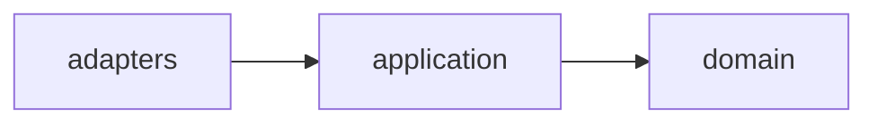

# Markdown Standards

Markdown conventions of this repository. They complement [`AGENTS.md`](../../AGENTS.md), and every agent must follow them when writing or reviewing any Markdown file (`AGENTS.md`, `README.md`, `CHANGELOG.md`, `docs/`, rules and skills).

Every rule below shows an undesirable example (❌) and how to fix it (✅).

## 1. Do not hard-wrap paragraphs

Write each paragraph, list item and blockquote on a single line, however long: editors and IDEs soft-wrap long lines in the UI, and the rendered output is the same. The 120-character limit applies to Python code only (Ruff), not to Markdown prose.

Line breaks still matter where Markdown requires them: code blocks, tables, directory trees and nested list items keep their own lines.

❌ Undesirable:

```markdown
Every commit message follows Conventional Commits. The file defines the allowed types
and their SemVer impact and the rules for scope, description, body, footers and
breaking changes.
```

✅ Fixed:

```markdown
Every commit message follows Conventional Commits. The file defines the allowed types and their SemVer impact and the rules for scope, description, body, footers and breaking changes.
```

## 2. Draw diagrams with Mermaid

Draw diagrams with **[Mermaid](https://mermaid.js.org/)**, never with ASCII art in `text` blocks. This applies to flowcharts, sequence diagrams, layer and component diagrams, state machines, class and entity-relationship diagrams, mind maps, timelines and any other chart. GitHub and VS Code (through the recommended `bierner.github-markdown-preview` extension pack) render Mermaid as a real diagram for human readers, and its declarative syntax states nodes and relationships explicitly, which LLMs read far more reliably than box-drawing characters. Browse the [Mermaid syntax reference](https://mermaid.js.org/syntax/) to pick the diagram type that best fits the content.

Command lines and commit message samples are not diagrams and stay in `text` blocks.

❌ Undesirable:

````markdown
```text
┌────────────┐      ┌─────────────┐      ┌────────┐
│  adapters  │ ───► │ application │ ───► │ domain │
└────────────┘      └─────────────┘      └────────┘
```
````

✅ Fixed:

````markdown

````

## 3. Draw directory trees with Mermaid's treeView-beta diagram

Draw directory trees with Mermaid's [`treeView-beta`](https://mermaid.js.org/syntax/treeView.html) diagram. It doesn't require the box-drawing tree (`├──`, `└──`, `│`) and descriptions follow the label after `##`.

❌ Undesirable:

````markdown
```text
tests/
├── unit/ # Fast, isolated tests without I/O
└── e2e/  # Critical user journeys
```
````

✅ Fixed:

````markdown

````
