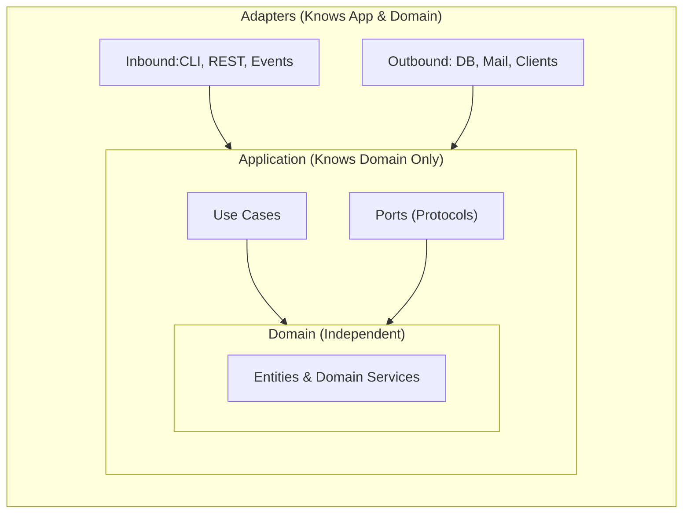

# Architecture Standards

Architectural patterns and design principles of this repository. They complement [`AGENTS.md`](../../../AGENTS.md) and [`code-standards.md`](../../rules/code-standards.md), and every agent must follow them when designing, writing or reviewing code inside `src/`.

The preferred architectural patterns are **Clean Architecture**, **Ports and Adapters (Hexagonal Architecture)** and **Domain-Driven Design (DDD)**. They complement each other: DDD models the business, Ports and Adapters isolates the business from technology, and Clean Architecture defines the dependency direction between layers.

**Object-oriented programming is the predominant paradigm**: entities, value objects, ports, use cases and adapters are all classes, and **each `.py` file holds a single class**, even a small one (see [One class per file](#one-class-per-file)).

## Why these architectures

These patterns were chosen for two goals, and every rule in this skill exists to serve them:

1. **Avoid high coupling between components.** Each component must know as little as possible about the others. Components talk through small, explicit contracts (ports) instead of reaching into each other's concrete classes, so a component can be changed, replaced or tested without a cascade of changes in the rest of the application.
2. **Inner components must never depend on, or even know about, outer components.** The application is organized in layers, from the innermost (the domain, the business rules) to the outermost (adapters, frameworks, databases, the web, the CLI). **Outer layers may know and use the inner layers in order to drive the application, but never the other way around.** The domain never imports, references or names anything from the application layer or the adapters, and the application layer never imports, references or names anything from the adapters.



Each layer is fully contained in the layer around it, and every arrow (a source code dependency) points inwards: from the adapters to the application and the domain, and from the application to the domain. No arrow ever leaves an inner layer towards an outer one.

Why this matters:

- **The business is the most stable and valuable part of the code; technology is the most volatile.** Databases, frameworks, external APIs and delivery mechanisms change far more often than the business rules. If the inner layers depended on them, every technical change would ripple into the business rules. With dependencies pointing inwards, technical changes stay confined to the outer layers.
- **Details are replaceable.** Swapping SQLite for PostgreSQL, a CLI for a REST API, or one email provider for another means writing a new adapter and wiring it in the composition root (`bootstrap.py`); the domain and the use cases stay untouched.
- **The core is testable in isolation.** Because the domain and the use cases know only abstractions, they can be exercised with fast test doubles, without databases, networks or frameworks (see [`tests.md`](../../rules/tests.md)).
- **Changes have a predictable blast radius.** Low coupling means a change in one component affects only the components that explicitly depend on its contract, which keeps the code easy to understand, review and evolve.

When the inner layer needs something that lives outside it (persisting data, sending a message, reading the clock), it **does not reach out to the outer layer**: it declares a port describing what it needs, and an outer adapter implements that port. The dependency in the source code is inverted, pointing inwards, even though the flow of control at runtime goes outwards. This is the reason for the [Dependency Rule](#the-dependency-rule), the [Dependency Inversion Principle](#d--dependency-inversion-principle) and the [Ports and Adapters](#ports-and-adapters) sections below.

## Recommended package layout


## One class per file

Object-oriented programming is the predominant paradigm, and **every `.py` file of the application core holds a single class**, with all of its logic in its body (see [rule 14 of `code-standards.md`](../../rules/code-standards.md#14-write-one-class-per-file-and-group-related-classes-in-folders)). This applies even to small classes, such as value objects, enums, exceptions and ports.

- **Classes of the same family go in separate files inside a folder named after the family**, never together in one file. The `OrderRepository` port, `InMemoryOrderRepository`, `SqliteOrderRepository` and `ParquetOrderRepository` are four files, not one.
- **Folders never break the Dependency Rule.** A family whose members live in different layers is split by layer: the port goes to `application/ports/` and its implementations to a family folder in `adapters/outbound/` (e.g. `adapters/outbound/repositories/`).
- **Name each file after its class in `snake_case`** (`PlaceOrder` → `place_order.py`), and import the class from its own module (`from my_awesome_project.application.use_cases.place_order import PlaceOrder`).

## The Dependency Rule

Dependencies always point **inwards**: `adapters → application → domain`. The domain knows nothing about the application layer, and neither of them knows about frameworks, databases or the web. Frameworks are details plugged in at the edges. An import that points outwards (from `domain/` to `application/` or `adapters/`, or from `application/` to `adapters/`) is always a violation, whatever the reason (see [Why these architectures](#why-these-architectures)).

❌ Undesirable — business rule coupled to the database and to a framework:

```python
# domain/order.py
import sqlite3


class Order:
    def save(self) -> None:
        connection = sqlite3.connect("app.db")
        connection.execute("INSERT INTO orders VALUES (?, ?)", (self.order_id, self.total))
        connection.commit()
```

✅ Fixed — the domain is pure; persistence is behind a port implemented by an adapter:

```python
# domain/order.py
from dataclasses import dataclass


@dataclass
class Order:
    order_id: str
    total: float
```

```python
# application/ports/order_repository.py
from typing import Protocol

from my_awesome_project.domain.order import Order


class OrderRepository(Protocol):
    def add(self, order: Order) -> None: ...
    def get(self, order_id: str) -> Order | None: ...
```

```python
# adapters/outbound/repositories/sqlite_order_repository.py
import sqlite3

from my_awesome_project.domain.order import Order


class SqliteOrderRepository:
    def __init__(self, connection: sqlite3.Connection) -> None:
        self._connection = connection

    def add(self, order: Order) -> None:
        self._connection.execute("INSERT INTO orders VALUES (?, ?)", (order.order_id, order.total))
        self._connection.commit()

    def get(self, order_id: str) -> Order | None:
        row = self._connection.execute("SELECT id, total FROM orders WHERE id = ?", (order_id,)).fetchone()
        if row is None:
            return None
        return Order(order_id=row[0], total=row[1])
```

## SOLID principles

The five SOLID principles guide the design of classes and modules in every layer. They are what make the Dependency Rule and the Ports and Adapters architecture work in practice.

| Letter | Principle             | In one sentence                                                      |
| ------ | --------------------- | -------------------------------------------------------------------- |
| **S**  | Single Responsibility | A class has only one reason to change.                               |
| **O**  | Open/Closed           | Open for extension, closed for modification.                         |
| **L**  | Liskov Substitution   | Any implementation can replace another without breaking its callers. |
| **I**  | Interface Segregation | Clients depend only on the methods they actually use.                |
| **D**  | Dependency Inversion  | High-level policies depend on abstractions, not on concrete details. |

### S — Single Responsibility Principle

A class must have only one reason to change, that is, it must serve a single actor or concern. Business rules, presentation and persistence change for different reasons and belong to different classes (and, usually, to different layers).

❌ Undesirable — the invoice calculates its total, renders itself as PDF and saves itself in the database:

```python
class Invoice:
    def calculate_total(self) -> Money:
        return sum((line.subtotal for line in self.lines), start=Money(Decimal(0)))

    def render_pdf(self) -> bytes:
        return PdfDocument(title=f"Invoice {self.invoice_id}", lines=self.lines).to_bytes()

    def save(self, connection: sqlite3.Connection) -> None:
        connection.execute("INSERT INTO invoices VALUES (?, ?)", (self.invoice_id, self.calculate_total().amount))
```

✅ Fixed — each class has a single responsibility, in its own layer:

```python
# domain/invoice.py
@dataclass
class Invoice:
    invoice_id: str
    lines: list[InvoiceLine]

    @property
    def total(self) -> Money:
        return sum((line.subtotal for line in self.lines), start=Money(Decimal(0)))


# adapters/outbound/renderers/pdf_invoice_renderer.py
class PdfInvoiceRenderer:
    def render(self, invoice: Invoice) -> bytes:
        return PdfDocument(title=f"Invoice {invoice.invoice_id}", lines=invoice.lines).to_bytes()


# adapters/outbound/repositories/sqlite_invoice_repository.py
class SqliteInvoiceRepository:
    def __init__(self, connection: sqlite3.Connection) -> None:
        self._connection = connection

    def add(self, invoice: Invoice) -> None:
        self._connection.execute("INSERT INTO invoices VALUES (?, ?)", (invoice.invoice_id, invoice.total.amount))
```

### O — Open/Closed Principle

A module must be open for extension but closed for modification: adding a new behavior must mean adding new code, not editing code that already works and is tested.

❌ Undesirable — every new customer tier requires editing the function and retesting every branch:

```python
def calculate_discount(customer: Customer, total: Money) -> Money:
    if customer.tier == "gold":
        return total * Decimal("0.10")
    if customer.tier == "platinum":
        return total * Decimal("0.20")
    return Money(Decimal(0))
```

✅ Fixed — each policy is a class, in its own file, behind a common protocol; adding a tier means adding a new file and never touches the existing policies:

```python
# domain/discount_policies/discount_policy.py
class DiscountPolicy(Protocol):
    def discount_for(self, total: Money) -> Money: ...


# domain/discount_policies/percentage_discount.py
@dataclass(frozen=True)
class PercentageDiscount:
    rate: Decimal

    def discount_for(self, total: Money) -> Money:
        return total * self.rate


# domain/discount_policies/no_discount.py
class NoDiscount:
    def discount_for(self, total: Money) -> Money:
        return Money(Decimal(0), total.currency)


# domain/discount_calculator.py
class DiscountCalculator:
    def __init__(self, policy_by_tier: Mapping[CustomerTier, DiscountPolicy]) -> None:
        self._policy_by_tier = policy_by_tier

    def calculate(self, customer: Customer, total: Money) -> Money:
        return self._policy_by_tier[customer.tier].discount_for(total)
```

### L — Liskov Substitution Principle

Every implementation of a port (or subclass of a base class) must honor the contract of its abstraction: it accepts the same inputs, returns the same kind of result and raises no new, unexpected exceptions. Callers must be able to use any implementation without knowing which one they received.

❌ Undesirable — the port promises `None` for a missing order, but this adapter raises `KeyError`, breaking every caller that checks for `None`:

```python
class OrderRepository(Protocol):
    def get(self, order_id: str) -> Order | None: ...


class CachedOrderRepository:
    def __init__(self) -> None:
        self._cache: dict[str, Order] = {}

    def get(self, order_id: str) -> Order | None:
        return self._cache[order_id]
```

✅ Fixed — the adapter honors the contract, so it can replace any other `OrderRepository`:

```python
class CachedOrderRepository:
    def __init__(self, repository: OrderRepository) -> None:
        self._repository = repository
        self._cache: dict[str, Order] = {}

    def get(self, order_id: str) -> Order | None:
        if order_id in self._cache:
            return self._cache[order_id]
        order = self._repository.get(order_id)
        if order is not None:
            self._cache[order_id] = order
        return order
```

### I — Interface Segregation Principle

Clients must not be forced to depend on methods they do not use. Prefer several small, role-based ports over one large "do everything" interface. Small ports are also easier to replace with test doubles.

❌ Undesirable — a read-only report use case depends on a port that can also write, delete and export, and every fake used in its tests must implement all of those methods:

```python
class OrderRepository(Protocol):
    def add(self, order: Order) -> None: ...
    def get(self, order_id: str) -> Order | None: ...
    def delete(self, order_id: str) -> None: ...
    def list_paid(self) -> list[Order]: ...
    def export_csv(self, path: Path) -> None: ...


class GenerateSalesReport:
    def __init__(self, repository: OrderRepository) -> None:
        self._repository = repository
```

✅ Fixed — each use case depends only on the role it needs; a single adapter may still implement several ports:

```python
# application/ports/paid_order_reader.py
class PaidOrderReader(Protocol):
    def list_paid(self) -> list[Order]: ...


# application/ports/order_writer.py
class OrderWriter(Protocol):
    def add(self, order: Order) -> None: ...


# application/use_cases/generate_sales_report.py
class GenerateSalesReport:
    def __init__(self, orders: PaidOrderReader) -> None:
        self._orders = orders
```

### D — Dependency Inversion Principle

High-level modules (use cases, domain) must not depend on low-level modules (databases, HTTP clients, frameworks). Both depend on abstractions, and the abstractions are owned by the high-level side. In this repository, that means use cases depend on ports defined in `application/`, and the concrete adapters are injected by the composition root (see [Ports and Adapters](#ports-and-adapters)).

❌ Undesirable — the use case imports and builds a concrete adapter, so it cannot run without a real SMTP server:

```python
from my_awesome_project.adapters.outbound.notifiers.smtp_notifier import SmtpNotifier


class CancelOrder:
    def execute(self, order: Order) -> None:
        order.cancel()
        SmtpNotifier("smtp.mail.com").send(f"Order {order.order_id} cancelled")
```

✅ Fixed — the use case depends on a port; the concrete adapter is chosen in `bootstrap.py`:

```python
# application/ports/notifier.py
class Notifier(Protocol):
    def send(self, message: str) -> None: ...


# application/use_cases/cancel_order.py
class CancelOrder:
    def __init__(self, notifier: Notifier) -> None:
        self._notifier = notifier

    def execute(self, order: Order) -> None:
        order.cancel()
        self._notifier.send(f"Order {order.order_id} cancelled")


# bootstrap.py
def build_cancel_order() -> CancelOrder:
    return CancelOrder(notifier=SmtpNotifier(settings.smtp_host))
```

## Ports and Adapters

- **Ports** are interfaces owned by the application layer. Define them with `typing.Protocol` (structural typing, no inheritance required) or `abc.ABC`.
- **Driven (outbound) adapters** implement ports to talk to the outside world (database, email, external APIs).
- **Driving (inbound) adapters** call the use cases (CLI, HTTP controllers, scheduled jobs).
- **Use cases depend on ports, never on concrete adapters.** Dependencies are injected through the constructor (Dependency Inversion Principle).

❌ Undesirable — use case instantiates its own infrastructure:

```python
class PlaceOrder:
    def execute(self, order: Order) -> None:
        repository = SqliteOrderRepository(sqlite3.connect("app.db"))
        repository.add(order)
        SmtpNotifier("smtp.mail.com").send(f"Order {order.order_id} placed")
```

✅ Fixed — dependencies are injected as ports:

```python
# application/ports/notifier.py
class Notifier(Protocol):
    def send(self, message: str) -> None: ...


# application/use_cases/place_order.py
class PlaceOrder:
    def __init__(self, repository: OrderRepository, notifier: Notifier) -> None:
        self._repository = repository
        self._notifier = notifier

    def execute(self, order: Order) -> None:
        self._repository.add(order)
        self._notifier.send(f"Order {order.order_id} placed")


# bootstrap.py (composition root)
def build_place_order() -> PlaceOrder:
    connection = sqlite3.connect(settings.database_path)
    return PlaceOrder(repository=SqliteOrderRepository(connection), notifier=SmtpNotifier(settings.smtp_host))
```

This makes use cases trivial to test with test doubles such as in-memory fakes, without real infrastructure (see [`tests.md`](../../rules/tests.md)):

```python
# tests/unit/test_place_order.py
class InMemoryOrderRepository:
    def __init__(self) -> None:
        self.orders: dict[str, Order] = {}

    def add(self, order: Order) -> None:
        self.orders[order.order_id] = order

    def get(self, order_id: str) -> Order | None:
        return self.orders.get(order_id)


class FakeNotifier:
    def __init__(self) -> None:
        self.messages: list[str] = []

    def send(self, message: str) -> None:
        self.messages.append(message)


def test_place_order_saves_order_and_notifies():
    repository = InMemoryOrderRepository()
    notifier = FakeNotifier()
    PlaceOrder(repository, notifier).execute(Order(order_id="42", total=100.0))
    assert repository.get("42") is not None
    assert notifier.messages == ["Order 42 placed"]
```

## Domain-Driven Design

- **Ubiquitous language:** name classes, methods and modules with the same terms the business experts use (in English). If the business says "an invoice is *issued*", write `invoice.issue()`, not `invoice.set_status(2)`.
- **Entities** have an identity that persists over time (`Order`, `Customer`).
- **Value objects** are defined only by their attributes, are immutable and validate themselves on creation. Use `@dataclass(frozen=True)`.
- **Aggregates** are clusters of objects changed together through a single root, which protects their invariants. External code never modifies inner objects directly.
- **Repositories** (ports) load and persist whole aggregates.
- **Domain services** hold business logic that does not naturally belong to a single entity.

❌ Undesirable — anemic model with primitive obsession; rules scattered outside the domain:

```python
@dataclass
class Order:
    items: list[dict[str, float]]
    status: str
    total: float


# Somewhere in a controller...
order.items.append({"price": -10.0, "quantity": 1})
order.total += -10.0
order.status = "paid"
```

✅ Fixed — rich model; value objects and an aggregate root protect the invariants, each class in its own file:

```python
# domain/money.py
@dataclass(frozen=True)
class Money:
    amount: Decimal
    currency: str = "USD"

    def __post_init__(self) -> None:
        if self.amount < 0:
            msg = f"Money amount cannot be negative: {self.amount}"
            raise InvalidMoneyError(msg)

    def __add__(self, other: "Money") -> "Money":
        if other.currency != self.currency:
            msg = f"Cannot add {other.currency} to {self.currency}"
            raise CurrencyMismatchError(msg)
        return Money(self.amount + other.amount, self.currency)

    def __mul__(self, factor: int) -> "Money":
        return Money(self.amount * factor, self.currency)


# domain/order_line.py
@dataclass(frozen=True)
class OrderLine:
    product_id: str
    unit_price: Money
    quantity: int

    @property
    def subtotal(self) -> Money:
        return self.unit_price * self.quantity


# domain/order_status.py
class OrderStatus(StrEnum):
    DRAFT = "draft"
    PAID = "paid"


# domain/order.py
@dataclass
class Order:  # Aggregate root
    order_id: str
    lines: list[OrderLine] = field(default_factory=list)
    status: OrderStatus = OrderStatus.DRAFT

    @property
    def total(self) -> Money:
        return sum((line.subtotal for line in self.lines), start=Money(Decimal(0)))

    def add_line(self, line: OrderLine) -> None:
        if self.status is not OrderStatus.DRAFT:
            msg = f"Cannot add lines to order {self.order_id} with status {self.status}"
            raise OrderNotEditableError(msg)
        self.lines.append(line)

    def pay(self) -> None:
        if not self.lines:
            msg = f"Cannot pay empty order {self.order_id}"
            raise EmptyOrderError(msg)
        self.status = OrderStatus.PAID
```
